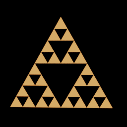
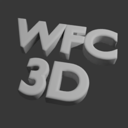

# Dan's Blender stuff 
## Add-ons / Extensions
Available Blender add-ons:
*  Sierpinski Triangle 
*  WFC 3D Generator 
*  SimpleToDo (watch on [Youtube](https://www.youtube.com/watch?v=Oy6hiUMn92U) how it works)

### Install Blender Extensions
- simply add this URL as a remote repository to your Blender repository list (Blender > Edit > Preferences > Get Extensions > Repositories > +):
    https://danrohde.github.io/blender-stuff/addons/index.json
- OR visit  https://danrohde.github.io/blender-stuff/addons/ and drag and drop the filename into your running Blender window

## Assets
* Since Blender 5.3 you can drag and drop following URL to a Blender window:
    * [https://raw.githubusercontent.com/DanRohde/blender-stuff/refs/heads/main/addons/asset_library_jbs_strange_assets-1.0.0.zip](https://raw.githubusercontent.com/DanRohde/blender-stuff/refs/heads/main/asset_library_jbs_strange_assets-1.0.0.zip)
* Since Blender 5.2 you can add the following URL as a Remote Asset Library: 
    * https://raw.githubusercontent.com/DanRohde/blender-stuff/refs/heads/main/Assets/
* Some [Geometry Nodes](./Assets/Geometry%20Nodes/) 
* Some [Shaders](./Assets/Shaders/) 
* Look at my [Youtube channel](https://www.youtube.com/@jonnybegood8230)

## Contact & Support
* Discord: https://discord.gg/VMq9G5Z2AB
